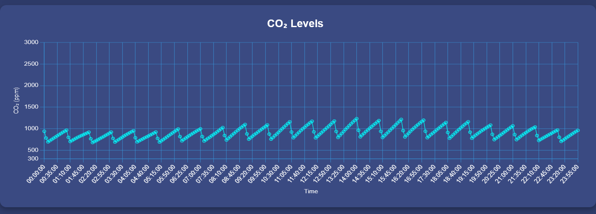
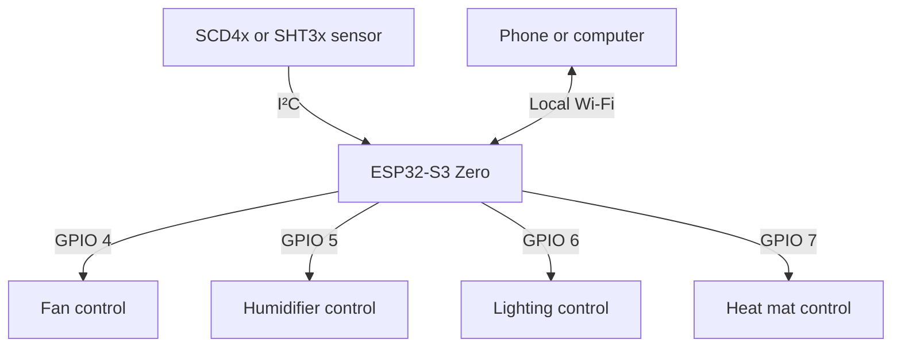

# Automated Monotub

An ESP32-S3 controller for a mushroom fruiting chamber. It records temperature, relative humidity and CO₂, runs a daily equipment schedule and serves a web interface over local Wi-Fi. Its adaptive humidifier uses the humidity trend between ventilation periods to decide when to run.

[Interface gallery](docs/interface.md) · [Firmware walkthrough](docs/firmware.md) · [Arduino sketch](Test_MainController/Test_MainController/Test_MainController.ino)

*Simulated data from the firmware’s Sensor screen. Select the chart to see the complete temperature, humidity and CO₂ view.*

## One ventilation cycle

At 14:00 the example schedule switches the fan on for ten minutes. The chart and the equipment log share the same clock, so you can follow the change in chamber air across three readings.

| Local time | Fan | CO₂ | Relative humidity |
| --- | --- | ---: | ---: |
| 14:00 | Switches on | 1,230 ppm | 89.40% |
| 14:05 | Running | 962 ppm | 88.26% |
| 14:10 | Switches off | 808 ppm | 86.63% |

The controller sets fan timing from the selected schedule. CO₂ is a monitored channel when an SCD4x sensor is used. [See the schedule and fan log](docs/interface.md)

## Inside the chamber controller

- **Humidity** can follow fixed on/off intervals or an adaptive routine that uses recent humidity and its trend. [Adaptive control diagram](docs/firmware.md#adaptive-humidification)
- **Heating and lighting** follow the selected profile. The heat mat switches across a 0.3 °C band and the lights have a daily on/off window. [Equipment controllers](docs/firmware.md#equipment-controllers)
- **The web panel** brings the schedule, measurements and timestamped equipment events into the same browser session. [Desktop and mobile screens](docs/interface.md)

This portfolio snapshot includes the Arduino sketch and the libraries present in the original project folder.
