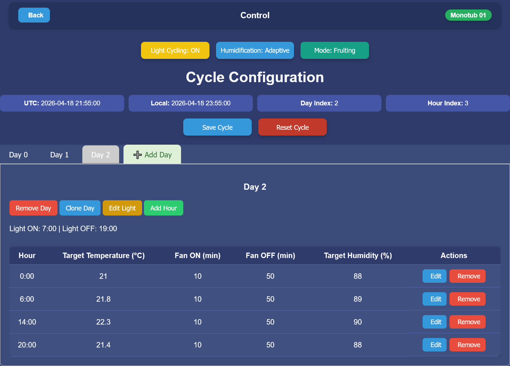
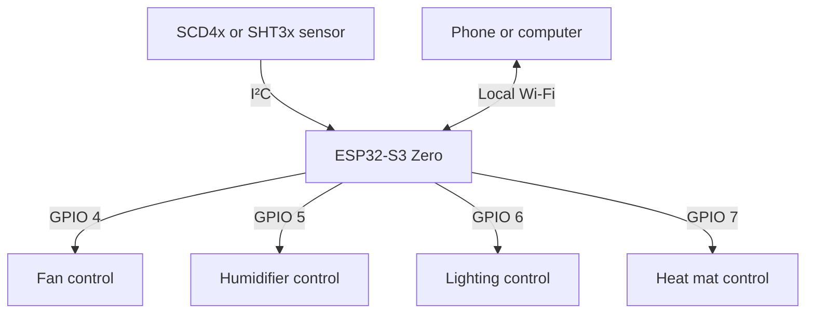

# Automated Monotub

Automated Monotub controls the climate inside a mushroom fruiting chamber. An ESP32-S3 Zero reads the sensors and runs a fan, humidifier, light and heat mat. From a phone or laptop on local Wi-Fi, you can edit the growing cycle and compare sensor readings with equipment activity.

[Interface gallery](docs/interface.md) · [Firmware walkthrough](docs/firmware.md) · [Arduino sketch](Test_MainController/Test_MainController/Test_MainController.ino)

*Simulated data from the Sensor screen. Select the chart to see temperature, relative humidity and CO₂ across the full day.*

## Growing cycle

A cycle can span up to 32 days and repeats after its last day. Each day has a lighting window and up to four time points. In **Fruiting** mode, the local clock determines which settings are active.

| Output | How it operates |
| --- | --- |
| Fan | Alternates the on and off durations set for the current time point. |
| Humidifier | Runs timed intervals or pulses toward a humidity target. When calculating the humidity trend, adaptive mode skips readings taken during ventilation and for one minute afterward. |
| Light | Follows the day's lighting window when light cycling is enabled. |
| Heat mat | Switches on below the temperature target and off once the chamber exceeds the target by 0.3 °C. |

In **Incubation** mode, the fan and light stay off and the heat mat uses a fixed 23.5 °C switch-on threshold. The humidifier continues in its selected mode. [Adaptive humidification diagram](docs/firmware.md#adaptive-humidification)

*Day 2 of the simulated cycle. The humidity target changes from 89% to 90% at 14:00, while the fan keeps its ten-minute run and fifty-minute pause.*

## Using the web panel

1. **Connect to the controller.** On local Wi-Fi, open its IP address or `http://<unit-name>.local` if mDNS is available. If it cannot join a saved network, connect to its `<unit-name>_AP` access point and open the gateway address.
2. **Set the clock in System.** Choose NTP and a time zone, or enter the local date and time manually.
3. **Edit the schedule in Control.** Set the day's lighting window and time points. Choose **Save Cycle** to keep them after a restart.
4. **Compare Sensor and Log.** Match a change on a sensor chart to the on/off events in the corresponding equipment tab.

With several controllers on the network, use **Cluster** to discover units and share the current cycle and operating modes.

## Hardware and measurements

The firmware supports an SCD4x sensor for CO₂, temperature and humidity, or an SHT3x for temperature and humidity. Both use the I²C bus on GPIO 1 (SDA) and GPIO 2 (SCL). The controller requests a reading every five seconds and appends a historical sample every five minutes. The Sensor page plots up to 288 historical samples, or about 24 hours. [Sensor acquisition](libraries/SensorReader/SensorReader.cpp) · [Pin assignments](libraries/MainController/MainController.cpp)

## One ventilation cycle

At 14:00 in the simulated example, the schedule starts a ten-minute fan run. The SCD4x records the drop in CO₂ across the next two readings.

| Local time | Fan | CO₂ | Relative humidity |
| --- | --- | ---: | ---: |
| 14:00 | Switches on | 1,230 ppm | 89.40% |
| 14:05 | Running | 962 ppm | 88.26% |
| 14:10 | Switches off | 808 ppm | 86.63% |

[Fan log for this interval](docs/interface.md#log) · [Full example dataset](docs/example-day.json)
