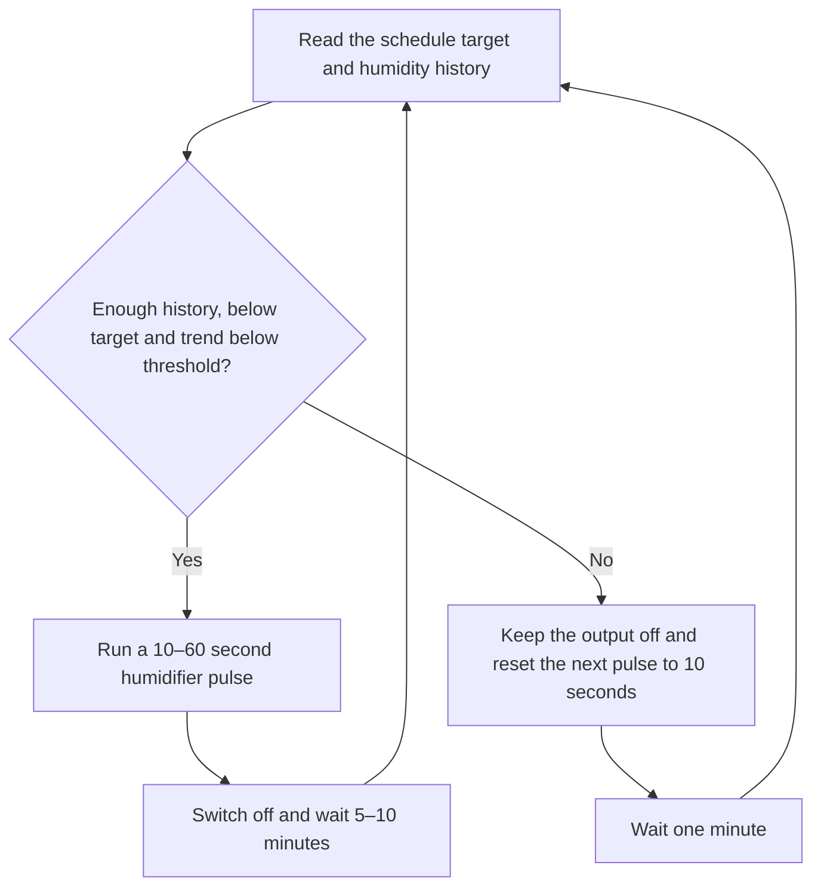

# Firmware walkthrough

[Project overview](../README.md) · [Interface gallery](interface.md)

The Arduino sketch starts `MainController`. It initializes shared state, timekeeping, Wi-Fi, sensors, the web server and the individual equipment controllers. The ESP32-S3 Zero configuration uses GPIO 1 for I²C data and GPIO 2 for the clock. [Startup and pin assignments](../libraries/MainController/MainController.cpp)

## From sensor to screen

`SensorReader` supports the SCD4x family for CO₂, temperature and humidity, and the SHT3x family for temperature and humidity. It requests recent readings every five seconds and appends a longer-term reading every five minutes. The web panel asks the shared buffer for the latest 288 historical entries and renders them in chronological order. [Sensor acquisition](../libraries/SensorReader/SensorReader.cpp) · [Shared history](../libraries/SharedResourceManager/SharedResourceManager.cpp) · [Web panel](../libraries/ServerController/ServerController.cpp)

## Adaptive humidification

Ventilation can briefly lower the measured humidity. The adaptive routine filters readings using the fan log before it calculates the recent mean and the trend. The trend is the newer half-window mean minus the older half-window mean, expressed in percentage points of relative humidity.

The routine requires at least 30 minutes of history. It uses up to 30 minutes for the recent mean and up to 60 minutes for the trend. A pulse is eligible when the mean is below the selected target and the trend is below 4 percentage points. Consecutive eligible pulses grow in 10-second steps up to 60 seconds. A larger deficit shortens the cooldown. [Humidifier state machine](../libraries/HumidifierController/HumidifierController.cpp) · [Mean, trend and fan masking](../libraries/SharedResourceManager/SharedResourceManager.cpp)

## Equipment controllers

| Output | Firmware behavior | Implementation |
| --- | --- | --- |
| Fan | Alternates the on and off durations for the active time point in fruiting mode | [FanController](../libraries/FanController/FanController.cpp) |
| Humidifier | Uses timed intervals or adaptive pulses | [HumidifierController](../libraries/HumidifierController/HumidifierController.cpp) |
| Light | Follows the day’s lighting window and the selected mode | [LightController](../libraries/LightController/LightController.cpp) |
| Heat mat | Switches on below the target and off above target plus 0.3 °C | [HeatpadController](../libraries/HeatpadController/HeatpadController.cpp) |

The cycle time binder selects the active day and time point. The web server exposes the schedule editor and device logs. The bundled Eventfun library retains its license, and Chart.js 4.5.0 is embedded as a compressed asset in the server library. [Cycle selection](../libraries/SharedResourceManager/CycleTimeBind.cpp) · [Eventfun license](../libraries/Eventfun/LICENSE) · [Embedded chart library](../libraries/ServerController/chartjs.h)
