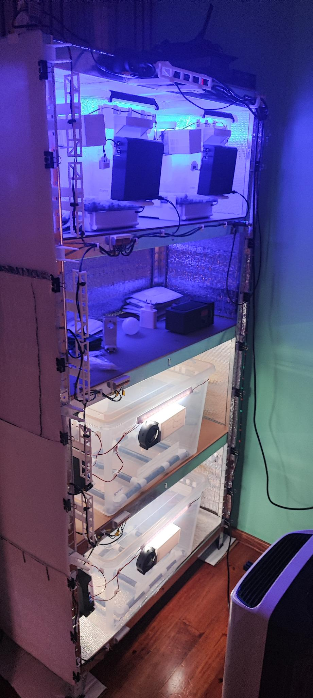
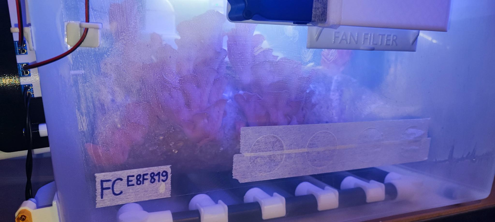
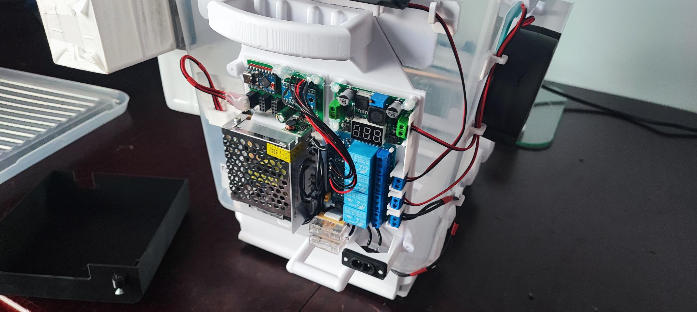

# Hardware photos

[Project overview](../README.md) · [Interface gallery](interface.md)

## Chamber rack

*Four chambers share a single rack across three levels.*

## Chamber during fruiting

*The fan filter is mounted near the top of the chamber wall.*

## Controller electronics

*The power supply, relay board and wiring terminals are mounted outside the chamber.*
