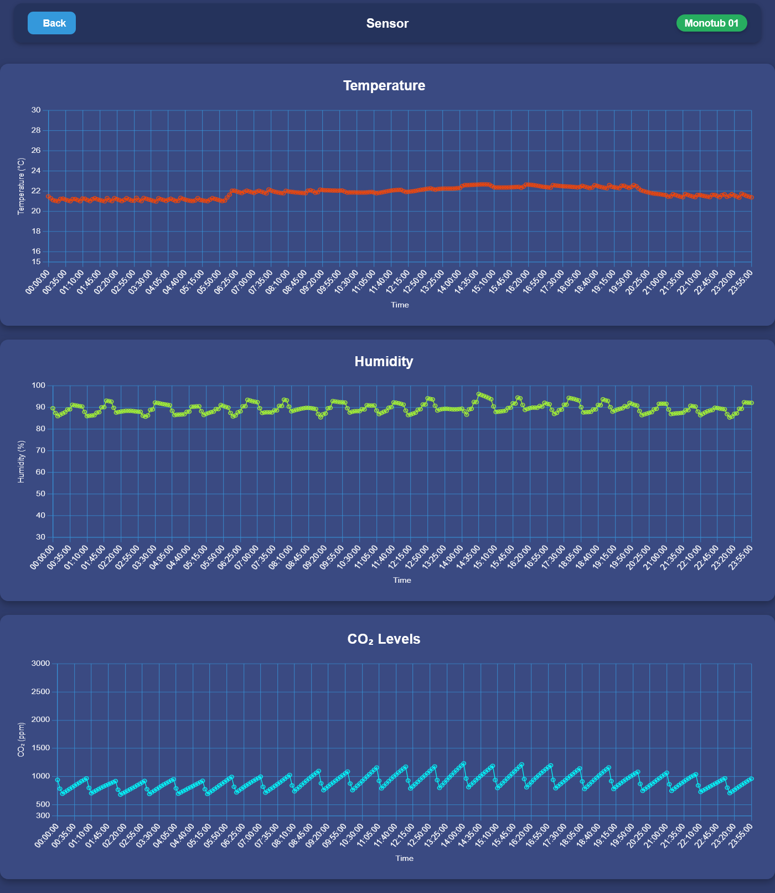
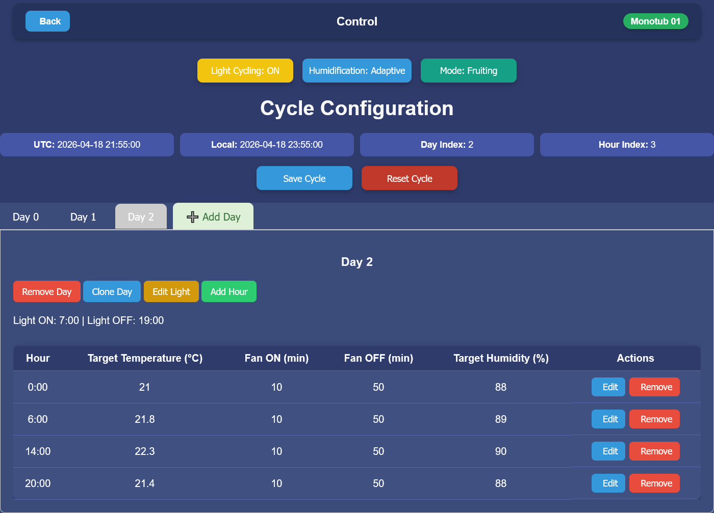
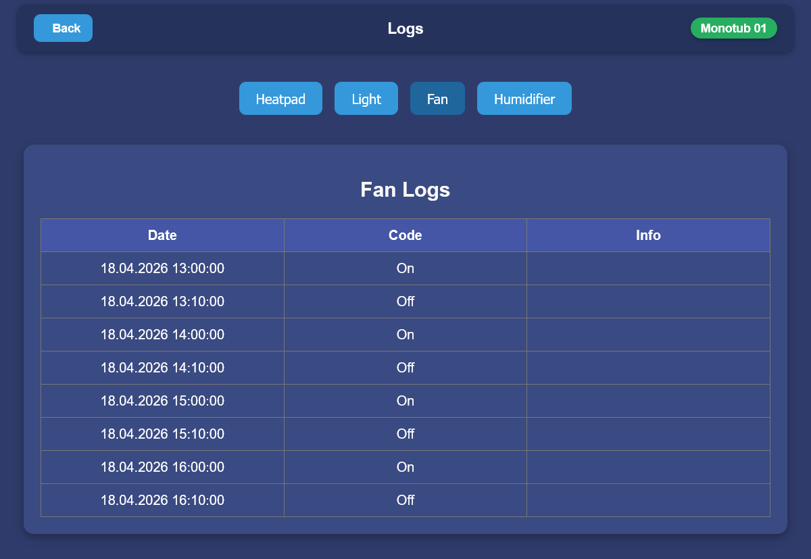
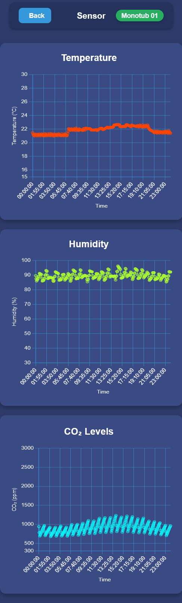

# Interface gallery

[Project overview](../README.md) · [Firmware walkthrough](firmware.md)

These are browser captures of the HTML, CSS and JavaScript generated by the ESP32 firmware. The Sensor charts use the same embedded Chart.js bundle served by the device. The four views share the readings, cycle settings and event log for 18 April 2026. [Cycle data](chamber-cycle.json)

## Sensor

The SCD4x charts show temperature in °C, relative humidity in percent and CO₂ in ppm. The screen shows 288 five-minute samples from 00:00 through 23:55 local time. The dips in CO₂ line up with the scheduled fan runs.

## Control

The selected profile is day 2. Lighting runs from 07:00 to 19:00. Each of the four time points has its own temperature and humidity targets. All four use ten minutes of ventilation followed by fifty minutes off. The top controls show light cycling, adaptive humidification and fruiting mode.

## Log

The Fan tab shows the afternoon excerpt from the same day. Its 14:00 on event and 14:10 off event bracket the drop from 1,230 to 808 ppm in the Sensor chart. Each equipment type has its own log tab.

## Mobile

The same Sensor page at a 390-pixel viewport width. The three charts retain their units and stack in the same order.

[Web interface source](../libraries/ServerController/ServerController.cpp)
